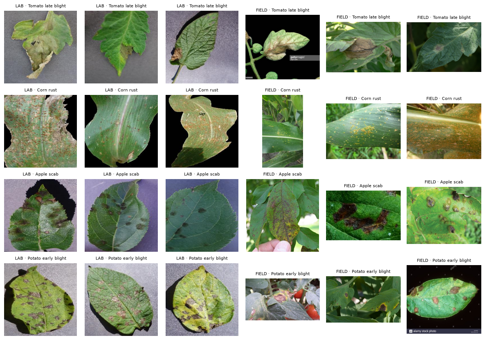

# Lab to Field: Crop Disease Detection That Works Outside the Lab

Plant-disease models score ~99% on lab photos but collapse on real field photos. This project measures that gap
honestly, closes part of it, and makes the model **say "not sure"** instead of guessing. The result is a
phone-sized model (8.5 MB, runs offline on a CPU) with a Streamlit demo.

**Live demo:** https://lab-to-field.streamlit.app

*Course: Edge AI and Robotics: Data Center Vision (Thapar Institute), Group Project 1, Modules 1–5.*



## Key results

| Model | Trained on | Lab accuracy | **Field accuracy** (95% CI) | Field ECE ↓ |
|---|---|---|---|---|
| CNN from scratch | lab photos | 95.8% | 8.9% (5.5–12.7) | 0.69 |
| MobileNetV3, fine-tuned | lab photos | 98.9% | 30.1% (24–36) | 0.52 |
| ResNet-50, fine-tuned | lab photos | 98.9% | 32.2% (27–39) | 0.41 |
| DINOv2 ViT-S, frozen | lab photos | 97.6% | 46.2% (40–53) | 0.33 |
| MobileNetV3 + background replacement | lab photos | 97.9% | 39.0% (33–45) | 0.43 |
| **Final: MobileNetV3, field track, bg aug, label smoothing** | lab + field photos | 98.0% | **64.4%** (58–70) | **0.09** |

- Chance level is 3.6% (28 classes). The field test is **PlantDoc test** (236 photos), never used for training or for choosing settings.
- With abstention, the final model answers **71%** of field photos at **77.8%** accuracy, and says "not sure" on the rest.
- FP16 ONNX: **8.5 MB**, same accuracy as FP32 (16.9 MB). INT8: 4.7 MB but −3.8 points (needs quantization-aware training).

## What we found

1. **The gap is real and large.** A scratch CNN goes from 95.8% (lab) to 8.9% (field) while staying 78% confident.
2. **Lab photos contain a shortcut.** A classifier that sees only the 4 image *corners* (background) predicts the disease 46% of the time on lab photos (chance 3.6%), but only 6% on field photos.
3. **Pretraining helps most among model choices**; self-supervised **DINOv2** features transfer best (46%), matching published results.
4. **Targeted augmentation beats generic augmentation.** Background replacement adds ~13 points; RandAugment adds nothing.
5. **Real field photos are worth the most:** ~2,000 PlantDoc photos lift MobileNetV3 from 30% to 64%.
6. **Label smoothing makes the model honest:** calibration error 0.44 → 0.16 at similar accuracy.

## Honest-evaluation checklist

- [x] PlantVillage split by **leaf** (the official split still shared 37 leaves between train and test; we removed them)
- [x] PlantDoc **train/test duplicates** found with perceptual hashing (15) and removed from training
- [x] Every setting chosen on **field validation**; field test only reported
- [x] 95% bootstrap confidence intervals on every field number
- [x] Calibration (ECE, reliability diagram) and abstention measured on held-out data

## Project structure

```
notebooks/            one notebook per course module, each with strategy, concepts, code, results and review questions
  01_problem_and_data        M1: task, datasets, leakage checks, background shortcut test
  02_cnn_from_scratch        M2 + M3: baseline CNN, tensor shapes, parameter counting
  03_transfer_learning       M2 + M3: linear probe vs fine-tune; MobileNetV3, EfficientNet, ResNet, DINOv2
  04_augmentation            M4: controlled augmentation ablation, background replacement
  05_training_choices        M5: optimizers, losses, activations, metrics, calibration, abstention, final model
  06_explain_and_export      Grad-CAM, ONNX export, FP16/INT8
src/lab_to_field/     reusable code: config, data, models, train, metrics, calibrate, experiment
app/streamlit_app.py  demo app (sample photos, upload or camera; top-3, "not sure", Grad-CAM)
scripts/              data download, notebook runner
results/              metrics (JSON) and figures
```

## Run it

```bash
uv sync                                                   # Python 3.12, PyTorch (CUDA 12.8)
uv run python scripts/download_plantvillage_subset.py     # ~480 MB PlantVillage subset
git clone --depth 1 https://github.com/pratikkayal/PlantDoc-Dataset data/raw/plantdoc
scripts/run_all_notebooks.sh                              # trains everything (~1.5 h on an RTX 4050)
uv run streamlit run app/streamlit_app.py                 # demo app
```

Saved results are reused: re-running a notebook reloads `results/<name>.json` instead of retraining.

## Data and licenses

- **PlantVillage** (Hughes & Salathé; Mohanty et al. 2016), [Hugging Face `mohanty/PlantVillage`](https://huggingface.co/datasets/mohanty/PlantVillage), CC BY-SA 3.0. We use a leaf-grouped subset of 28 classes.
- **PlantDoc** (Singh et al. 2020), [github.com/pratikkayal/PlantDoc-Dataset](https://github.com/pratikkayal/PlantDoc-Dataset), CC BY 4.0. Sample photos in `app/samples/` come from its test set.

## Limitations and next steps

- PlantDoc is small (236 test photos) and has some label noise; it contains no wheat, rice or cotton. Punjab staples need their own data.
- Grad-CAM shows the final model still sometimes uses background cues.
- Next (Group Project 2): distil DINOv2 into MobileNetV3, quantization-aware training for INT8, leaf detection/segmentation (Module 6), expert-labelled Punjab phone photos, Android app.

Not a substitute for an agronomist.
